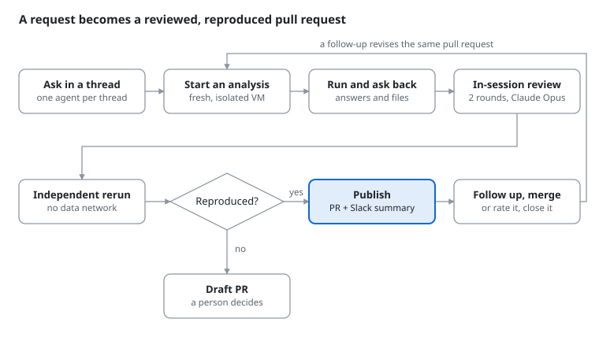
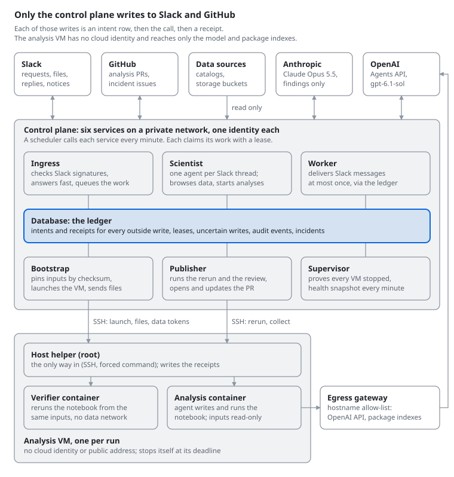
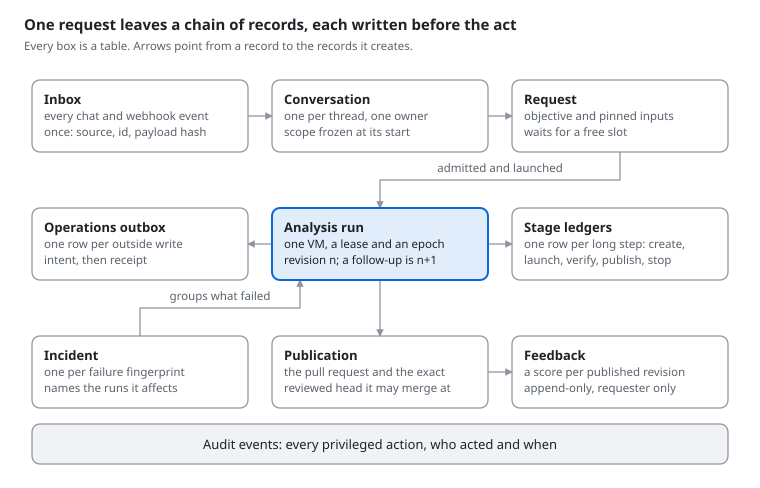
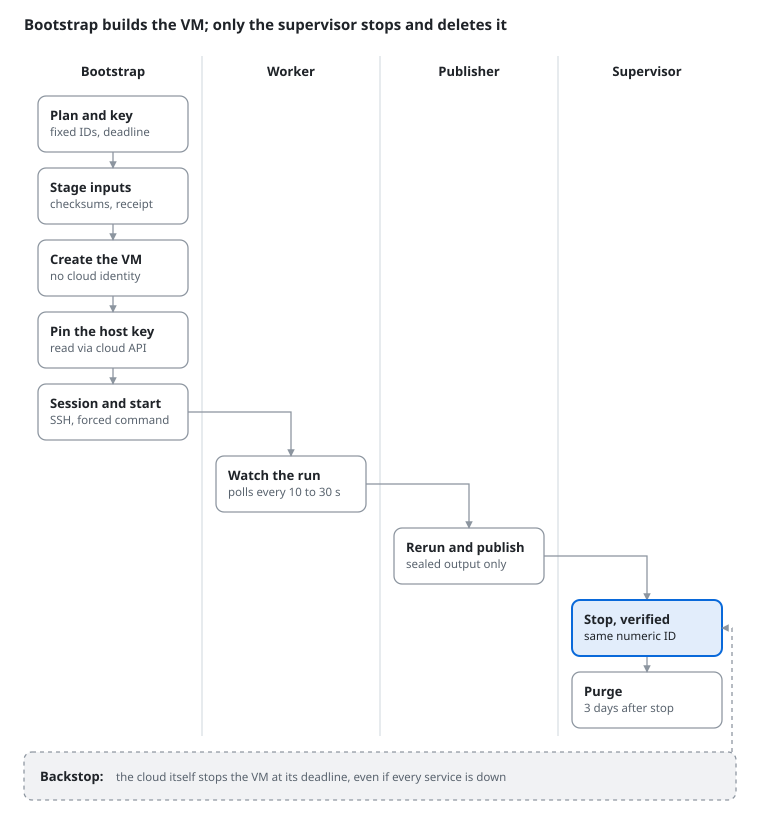
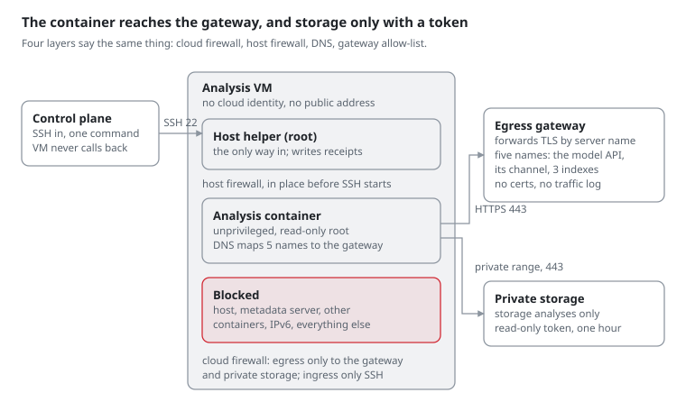
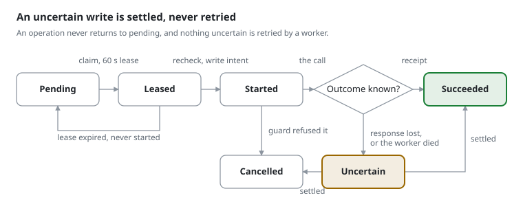
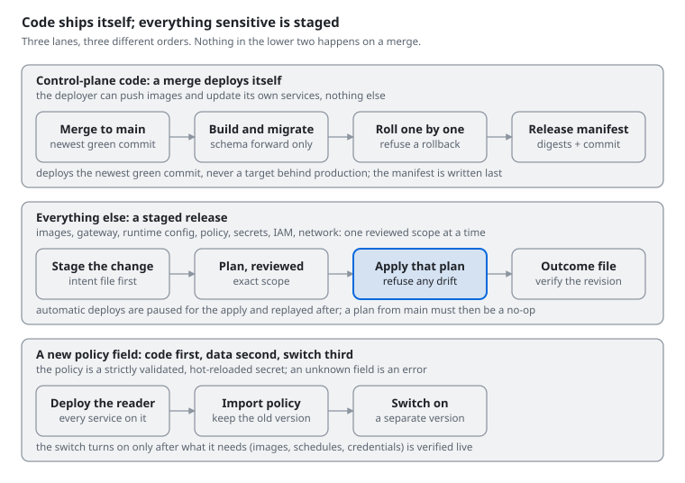
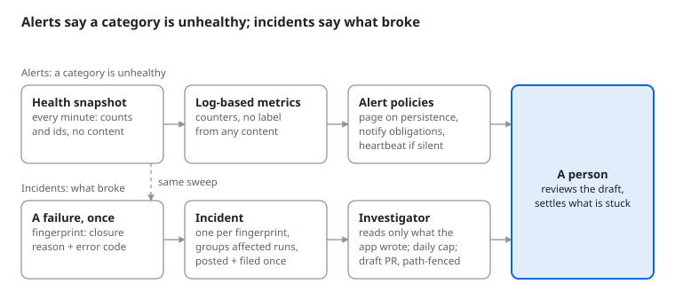

# Blueprint: an AI scientist that runs verified analyses

*As of November 5, 2026 · Arman Aksoy*

## How to use this document

This is a blueprint, not code: the architecture, rules and hard lessons from building Val, an AI scientist that takes requests in Slack and runs real analyses on sensitive data. It is written so you can hand it to your own AI coding agent and ask it to design something similar without repeating our mistakes.

It is for teams whose agent does more than chat: it launches compute, reads private data, writes to Slack and GitHub, and must never do any of that twice or out of scope.

If you are an LLM reading this on someone's behalf:

- Treat **The invariants** as requirements. Each one exists because we broke it, or nearly did.
- Treat **Mistakes** as test cases. For each rule, ask whether your design would have caught that failure.
- Use **Checklists** as a review pass over your own design before you build.
- Read product names (Slack, GitHub, Cloud Run, PostgreSQL, Terraform) as examples. The pattern matters, not the vendor. The models are named (OpenAI's gpt-6.1-sol through the Agents and Responses APIs, Anthropic's Claude Opus 5.5) because the split between the model that works and the model that reviews is part of the design.
- Do not copy numbers blindly. Timeouts and limits fit our load: a small team, a few dozen analyses a week, about ten conversations at once.

Left out on purpose: source code, internal identifiers, account and resource names, network addresses, people, and anything about the data itself.

Where to start, by reader:

| Reader | Start here | Then |
| --- | --- | --- |
| A scientist who will use it | [What the system does](#what-the-system-does), with the request journey drawn | [Operating the system](#operating-the-system): humans in the loop |
| An architect or backend engineer | [Architecture at a glance](#architecture-at-a-glance), [The invariants](#the-invariants) with the ledger and the write cycle drawn, [Decisions that held up](#decisions-that-held-up) | [The machines in detail](#the-machines-in-detail) |
| A security reviewer | [The machines in detail](#the-machines-in-detail): the three levels of trust, the network drawn, what reaches the VM | [Worked example: Google Cloud](#worked-example-google-cloud) |
| An operator or on-call engineer | [Operating the system](#operating-the-system), with both paths to production and the incident pipeline drawn | [Checklists an LLM can apply](#checklists-an-llm-can-apply), [Mistakes](#mistakes-what-they-cost-and-the-rule-each-left-behind) |
| An AI coding agent asked to build one | [The invariants](#the-invariants), [Mistakes](#mistakes-what-they-cost-and-the-rule-each-left-behind), [Checklists](#checklists-an-llm-can-apply), [If we started again tomorrow](#if-we-started-again-tomorrow) | Everything else, in order |

## What the system does

Val turns a Slack message into a reviewed, independently reproduced analysis published as a pull request. Nobody on the requesting side writes code, and the system refuses any step it cannot prove it is allowed to take.

What a user experiences:

1. **Ask in a thread.** "How does this gene's isoform usage compare across the patient's two samples?" A persistent agent, one OpenAI Agents API session per Slack thread, answers questions, browses only the data that thread may see, and asks what it needs to know.
2. **Start an analysis.** The conversation requests a job with an objective and pinned inputs. A fresh, isolated VM starts, and an analysis agent writes and runs a notebook there.
3. **Answer its questions.** The running analysis can ask the owner a question, with suggested answers. The owner's reply, and any files they attach, are delivered back into the run.
4. **In-session review.** Before finishing, the analysis asks a reviewer model from a different vendor, Anthropic's Claude Opus 5.5, for blocking and major findings, and revises. Two rounds by default.
5. **Independent rerun.** A separate container re-executes the notebook from the same inputs, with no network to the data sources. The declared results must reproduce.
6. **Publish.** The verified notebook, report, figures and conversation go to a pull request in an analyses repository, after a final independent review. Slack gets a short summary, the review verdict and the cost.
7. **Follow up.** "Now split it by timepoint" revises the same pull request. Open reviews get reminders and close after 14 days.
8. **Rate it.** A reply of "feedback 4/5" from the requester stores a score and a comment against the exact published revision. It never gates a merge, and it still works after the conversation has closed.

<picture>
  <source media="(prefers-color-scheme: dark)" srcset="diagrams/1-request-journey-dark.svg">
  
</picture>

*Request journey · seven steps, one gate, one loop*

Read it left to right, then down: the rerun is the gate, a follow-up revises the same pull request, and only the owner's own words merge or close it.

What it will not do, by construction:

- Give the analysis VM a cloud identity or a public address, or let it reach anything beyond OpenAI's API and the package indexes.
- Write to any data source.
- Publish anything that did not reproduce. A final review with blocking findings opens the pull request as a draft for a person.
- Retry a Slack, GitHub or model write whose outcome is unknown.
- Act for someone who cannot see the data the request needs.

In its first six weeks it ran a little over a hundred analyses for a small team. A typical run took 20 to 60 minutes and cost about $2 to $3 in model usage. A large single-cell comparison cost about $11.

## Architecture at a glance

<picture>
  <source media="(prefers-color-scheme: dark)" srcset="diagrams/2-components-dark.svg">
  
</picture>

*Components and trust zones · six services, one ledger, one VM per run*

Read it top down: people and outside services, the control plane that alone writes to them, and the disposable VM that only computes.

Three trust boundaries do most of the work:

- **Outside to control plane.** Chat events are signature-checked and queued before anything acts on them. Every write back to chat or the code host is a ledger row first.
- **Control plane to VM.** There is one door: SSH to a forced-command helper whose actions are a fixed list. The VM cannot open a connection to the control plane.
- **VM to the internet.** One gateway with a hostname allow-list. A storage analysis also gets private, read-only access to the buckets it named, with a token that expires within the hour unless renewed.

<picture>
  <source media="(prefers-color-scheme: dark)" srcset="diagrams/3-ledger-dark.svg">
  
</picture>

*What the ledger holds · nine tables, one audit trail*

Each box is a table whose rows hold an intent before the act and a receipt after it. Nothing outside the control plane is called until its row exists, and the audit trail underneath records who acted.

The vendors, by role:

| Role | Model | How it is called |
| --- | --- | --- |
| Conversation agent, request planner, topic triage, analysis agent | OpenAI gpt-6.1-sol at high reasoning effort, pinned in the runtime configuration (gpt-6-astra at launch, then gpt-6-sol at medium) | The conversation agent and the analysis agent are Agents API sessions: a conversation session has no environment; an analysis session's environment is self-hosted on the VM, where OpenAI's Codex exec-server runs pinned and hash-checked. The planner and triage are single Responses API calls to the same model, the planner at the configured effort and triage at the vendor's default |
| In-session review, two rounds, and the final review | Anthropic Claude Opus 5.5 | Messages API over plain HTTPS, from the publisher only |
| Incident investigator | Claude Code on Claude Opus 5.5 | A GitHub Actions workflow with no production access; its fix is a draft pull request |
| Cost beside each analysis | Both vendors' list prices, kept in the policy | Usage recorded per call, summed per analysis |

The split is deliberate: the model that wrote the work never reviews it, and a change of model is a configuration release, not a code change.

## The machines in detail

The analysis VM is where model-written code runs next to sensitive data, so most of the hard engineering lives there. This section is the level of detail an LLM needs to build one.

### Machine roles

| Machine | How many | Identity | Job |
| --- | --- | --- | --- |
| Analysis VM | One per analysis, never reused | None: no service account, no public address | Hosts the root helper, the analysis container and the verifier containers. Four vCPUs and 16 GB by default, a 50 GB disk, a six-hour life (24 at most). Storage analyses add up to about 4 TB of scratch. |
| Egress gateway | One, small, always on | None | A TCP proxy that reads the TLS server name and forwards only names on its allow-list. It holds no certificates and logs no traffic. |
| Image builders | Temporary, one per image release | Registry read for the executor builder, none for the gateway builder | Installs the host software on a fresh base image, is captured as the boot image, then deleted. Reached through an identity-aware tunnel, never a public address. |
| Control-plane services | Six, scale to zero | One each | Only three may touch a VM: bootstrap creates it and talks to it, the publisher talks to it, the supervisor stops and deletes it. |

### What a VM is built from

Three pinned artifacts, all named in a versioned runtime configuration:

- **The executor image.** A container image built in CI on the target architecture and pinned by digest. It holds the analysis stack, a notebook helper, and OpenAI's Codex exec-server, itself version-pinned and hash-checked. It runs as an unprivileged user.
- **The boot image.** A base Linux image with the container runtime, a restricted SSH server, the host helper, and the executor image preloaded, so nothing is pulled at run time. The installer works offline from hash-locked packages, disables the normal SSH service and the cloud's startup scripts, and deletes the builder's host keys. It is pinned by exact image ID; image families are refused, and the controller checks that each new VM's disk was made from that ID.
- **The repository snapshot.** A pinned commit exported as an archive and checked by hash, so the agent can read the team's skills and helper code. It is mounted read-only, and the verifier never sees it.

The same configuration pins the model and its reasoning effort (gpt-6.1-sol at high, today), the number of review rounds and the digest of the data catalog. Changing any of them is a staged release.

### The life of one VM

<picture>
  <source media="(prefers-color-scheme: dark)" srcset="diagrams/4-vm-life-dark.svg">
  
</picture>

*One VM's life · four services, nine steps, one backstop*

Each service owns a fixed slice of the VM's life, and the IAM grants match: only the supervisor can stop or delete a VM.

1. **Admission.** The request waits, saved, until a slot is free under a global limit, a per-person limit and daily caps. Planning and clarifying questions take no slot.
2. **Plan.** Before any cloud call, the controller saves an immutable plan: fixed request IDs for the create and the stop, and an absolute deadline from the database clock. It generates an SSH key pair for this analysis alone. The private key is stored encrypted under a wrapping key that never leaves the control plane; only the public key goes into the VM's metadata.
3. **Stage inputs.** The controller reads each pinned input with its own identity, which may read only the reviewed object names. It checks size and checksum, records a SHA-256 receipt, and packs the inputs and the repository snapshot into two archives.
4. **Create.** One insert call, carrying the saved request ID. The VM has no service account, one private IPv4 interface, project-wide SSH keys blocked, the serial console and OS-level login off, shielded boot, no automatic restart, and a cloud-enforced termination time equal to the deadline. Every later read checks this shape, and any drift closes the analysis and stops the VM.
5. **Pin the host key.** On first boot the VM generates its host keys, installs the controller's public key behind a forced command, and publishes its own host key through the cloud's authenticated metadata API. The controller reads it there. There is no trust on first use.
6. **Create the agent session.** OpenAI's Agents API hosts the agent's session, and the VM becomes its self-hosted execution environment. The session is created with no input, so a lost response is recovered by searching for it, never by creating a second one.
7. **Start.** A launch plan binds the VM's numeric ID, the boot image, the executor digest, the commit, the input receipt's hash and the deadline. Over SSH the controller sends a small JSON header and then both archives, rechecking authorization before every megabyte. The helper writes a start intent, unpacks, checks every hash, and starts the container exactly once.
8. **Connect out.** The container's launcher connects outward to the Agents API session as its execution environment, with a key that can connect environments and do nothing else. The controller waits until the session reports the environment connected, hands monitoring to the turn monitor, and only then sends the first message.
9. **Run.** The monitor polls the session every 10 to 30 seconds. A question goes to the thread. A review request makes the publisher collect a draft and call the reviewer. Files and storage tokens arrive through the helper.
10. **Verify and publish.** When the agent's turn completes, the publisher asks the helper to run the verifier on the same VM, then collects the sealed result and publishes it.
11. **Stop.** Ten minutes after publication, the VM is retired: stopped and its slot released, while the pull request stays open. Any closing analysis is stopped by the supervisor. A stop counts only when the stop operation completed and the VM with the same numeric ID reads as terminated. The cloud's own termination time is the backstop when everything else is down.
12. **Purge.** Three days after a verified stop, the supervisor re-reads the VM's identity and deletes it with its disk. A VM is never restarted or reused. A revision gets a new VM and receives the previous release's files read-only.

### Inside the VM: three levels of trust

**The host helper, as root.** It is the only way in. The SSH server accepts one account with keys only, no terminal and no forwarding, and forces every login into one command. Sudo allows that command and nothing else. The helper reads a root-owned file naming the approved executor digest, and takes one action per request:

| Action | What it does |
| --- | --- |
| probe | Checks identity, image, dispatch window and firewall; writes nothing |
| start | Stages the archives once, writes a start intent, runs the container |
| status | Inspects the exact container against the plan |
| storage token, token status | Replaces or reports the storage token |
| late inputs, late inputs status | Commits one delivery of files to the running analysis, or reports the receipt |
| collect, collect draft | Returns the agent's report, used for in-session review |
| verify start, verify status, collect verified | Runs the independent verifier and returns its sealed output |

Every action first checks the host firewall rule by rule and refuses on any drift. File reads refuse links, devices and files that change while being read, and every size is capped. A reply is one JSON receipt line followed by an uncompressed archive whose size and SHA-256 the receipt names.

**The analysis container, unprivileged.** It runs the executor image by digest with a read-only root filesystem, a fixed non-root user, every capability dropped, no privilege escalation, limits on memory, CPU and processes, no restart and no logging. Its mounts:

| Mount | Access | Holds |
| --- | --- | --- |
| Inputs | Read-only | The checksum-verified inputs |
| Repository | Read-only | The pinned snapshot |
| Late inputs | Read-only | Files sent while it runs, with their receipt |
| Outputs | Read-write | The notebook, report and results |
| Environment | Read-write | Packages it installs, recorded in a hash lock |
| Scratch | Read-write | Storage analyses only |

Credential files are bind-mounted one at a time. The launcher refuses any that is a link, has a second hard link, or is readable by anyone but its own user.

**The verifier containers.** Same image, same hardening, a fresh output directory. A restore container reinstalls the agent's hash-locked packages with access to the package indexes only. The rerun container then executes the notebook's source from scratch with no network, or with storage access only for a storage analysis. It gets no repository snapshot, none of the agent's outputs and no keys. The host compares the declared results exactly, rewrites the report itself, and seals the directory.

### The network, layer by layer

1. **Cloud firewall.** The executor subnet may send only HTTPS to the gateway, plus private storage access for storage analyses. Everything else is denied. Nothing may connect in except SSH from the control-plane subnet.
2. **Host firewall.** Installed at boot, before the SSH server starts. The container may reach the gateway, and for a storage analysis the private storage address. It cannot reach the host, the cloud metadata server, other containers, or anything over IPv6.
3. **DNS.** The container's resolver points at an address where nothing listens. Names resolve only through fixed host entries that map each allowed hostname to the gateway.
4. **Gateway.** A TLS connection is forwarded only if its server name is on a five-name list: the OpenAI API, its environment channel, and three package indexes. TLS passes through untouched.

<picture>
  <source media="(prefers-color-scheme: dark)" srcset="diagrams/5-network-dark.svg">
  
</picture>

*The network · one way in, two ways out, four layers*

The only inbound path is SSH from the control plane into the forced command. Outbound, the container's packets can go to the gateway, which forwards five server names, or, for a storage analysis, to the private storage range with a one-hour token. Each layer would block the rest on its own.

The gap we accepted: filtering by server name cannot stop code from encoding data into requests to a package index. Closing it needs either an install phase before inputs and keys arrive, or an internal proxy that serves only package downloads. Whatever you choose, write the decision down.

### What reaches the VM, and what never does

| Credential | Scope | Lifetime |
| --- | --- | --- |
| SSH public key | Opens the forced command only | One analysis |
| Model environment key | Connects an execution environment to OpenAI's Agents API; agent code can read it | Until rotated; separate from the application key |
| Storage token | Read-only, downscoped to the one to five buckets the request named | One hour, renewed while the owner stays authorized, including while the run waits on a question |

Never on the VM: a cloud identity, the model provider's application key, the key-wrapping key, the data catalog's credentials, chat or code-host tokens, or a database connection.

## Worked example: Google Cloud

This is how we built it on Google Cloud. Every name below is a Google Cloud product, API field or documented address, not one of our resources. Angle brackets mark what you fill in: `<project>`, `<zone>`, `<prefix>` (a short name prefix that every disposable VM and disk carries), `<bucket>`.

### Component map

| Component | Google Cloud service | Our settings |
| --- | --- | --- |
| Six control-plane services | Cloud Run services | One service account each. Internal ingress only, except the chat-facing service behind an external HTTPS load balancer. Direct VPC egress to private ranges only. Deletion protection on. |
| Wake-ups | Cloud Scheduler, plus Cloud Tasks queues as hints | Every job runs each minute with an OIDC token from a dedicated invoker account. Queues only shorten latency; the database owns the work. |
| Database | Cloud SQL for PostgreSQL | Private IP only, encrypted connections only, daily backups, point-in-time recovery. Services connect through the Cloud SQL Auth Proxy as a sidecar container. |
| Schema migration | Cloud Run job | One task, zero retries, mounting only the database password. |
| Secrets, policy, runtime configuration | Secret Manager | Mounted as files, with an accessor grant per secret per service. Keys are pinned to a version; the policy is reread on every authorization. |
| Images | Artifact Registry | Referenced by digest everywhere. |
| Analysis VMs and the gateway | Compute Engine | Settings below. |
| Private storage reads | Private Google Access | Only on the executor subnet, only when storage analyses are on. |
| Downscoped storage tokens | IAM Credentials API and Security Token Service | A Credential Access Boundary limits each token to the request's buckets. |
| Working storage | Cloud Storage | Sealed releases, repository snapshots, release manifests. |
| Monitoring | Cloud Logging metrics, Cloud Monitoring alert policies | A Slack notification channel created outside Terraform. |
| Deploys from CI | GitHub Actions with Workload Identity Federation | No service account keys anywhere. |
| Image builders | Compute Engine, reached through IAP TCP forwarding | Created and deleted around each image release. |
| Infrastructure | Terraform, with state in Cloud Storage | Plan-only tests with mocked providers. |

Our sizes, as a starting point:

| Resource | Size |
| --- | --- |
| Chat-facing service | 1 to 2 instances, concurrency 4, 30-second timeout |
| Worker, supervisor | Up to 2 instances, concurrency 1, 60 and 180 seconds |
| Conversation service | Up to 10 instances, 2 GiB, 300 seconds |
| Bootstrap | Up to 5 instances, 2 GiB, 1,200 seconds, 3 VM launches at once |
| Publisher | Up to 3 instances, 2 GiB, 600 seconds |
| Cloud SQL | 1 vCPU, 3.75 GB, zonal, 20 GB SSD growing to 100 GB |
| Analysis VM | e2-standard-4, about 50 GB balanced persistent disk |
| Gateway | e2-small |

### Network

One VPC with three subnets: one for Cloud Run's Direct VPC egress, one for the analysis VMs, and a small one for the gateway. Firewall rules target network tags. Allows sit at priority 900, and one deny-all egress rule at priority 1000 covers both the executor and the gateway tags.

| Rule | Direction | From | To |
| --- | --- | --- | --- |
| SSH to executors | Ingress | Control subnet | Executor tag, TCP 22 |
| Executor to gateway | Egress | Executor tag | The gateway's internal IP, TCP 443 |
| Executor to private storage | Egress | Executor tag | `199.36.153.8/30` (private.googleapis.com), TCP 443 |
| Gateway out | Egress | Gateway tag | Any address, TCP 443, plus DNS to the resolvers it uses |
| Deny the rest | Egress | Executor and gateway tags | Everything |

- **Cloud NAT** covers only the gateway subnet. The analysis VMs have no NAT and no external address.
- **Cloud NAT is IPv4-only**, so the gateway's resolver must prefer IPv4. Otherwise HAProxy can pick an AAAA answer it cannot reach.
- **Private storage** needs three pieces: Private Google Access on the executor subnet, the egress rule to `199.36.153.8/30`, and inside the container a fixed host entry that maps `storage.googleapis.com` to that range.

### The analysis VM, field by field

The `instances.insert` body that made the VM safe:

```
serviceAccounts: []                         # no identity at all
networkInterfaces: [{subnetwork: <executor subnet>}]   # no accessConfigs: no external IP
tags: {items: [<executor tag>]}
metadata:
  block-project-ssh-keys: TRUE
  serial-port-enable: FALSE
  enable-oslogin: FALSE
  enable-guest-attributes: TRUE              # how the VM publishes its host key
  <your key>: <per-analysis SSH public key>
scheduling:
  automaticRestart: false
  onHostMaintenance: MIGRATE
  terminationTime: <absolute deadline>       # enforced by Compute Engine itself
  instanceTerminationAction: STOP
shieldedInstanceConfig: {enableSecureBoot, enableVtpm, enableIntegrityMonitoring: true}
disks: [{boot: true, autoDelete: true,
         initializeParams: {sourceImage: <exact image, never a family>, diskType: pd-balanced}}]
```

- Send `requestId` on every insert, stop and delete, so Compute Engine deduplicates a retried call. We derive the delete's ID from the create's.
- Before the first SSH, check the boot disk's `sourceImageId` against the approved image's numeric ID.
- The VM publishes its SSH host key as a guest attribute; the controller reads it with `getGuestAttributes`. Anything that can reach the metadata server can write guest attributes, so the host firewall must block the container from `169.254.169.254`.
- Keep operation receipts in your own database. Compute Engine expires old operations, and an uncertain create followed by an empty operation lookup is not proof that nothing was created.

### IAM patterns

- **One service account per service; none on the VMs.** No default compute service account anywhere.
- **Custom roles with only the permissions used.** Create (instances and disks create, set metadata, tags and labels), observe (instances get, get guest attributes, disks get), stop (instances get and stop), purge (instances delete, disks get and delete). Only the supervisor holds stop and purge.
- **IAM Conditions bound by name.** Compute Engine's stop call addresses a VM by name with no numeric-ID precondition, so bound every grant to your disposable names and exclude long-lived VMs by exact name:

```
resource.name.startsWith('projects/<project>/zones/<zone>/instances/<prefix>-')
  && resource.name != 'projects/<project>/zones/<zone>/instances/<prefix>-gateway'
```

- **Image and subnet use** are granted on the one approved boot image and the executor subnet only.
- **Object reads by exact name.** The controller's source reads are conditioned per object. Such a condition covers every generation of that object, so the code must pin the generation itself.

```
resource.type == 'storage.googleapis.com/Object'
  && resource.name == 'projects/_/buckets/<bucket>/objects/<object>'
```

- **Prefix-scoped writes.** A bucket grant conditioned on `resource.name.startsWith('projects/_/buckets/<bucket>/objects/<prefix>/')` can scope create, get and delete, but not `storage.objects.list`, which is bucket-wide. Write through the JSON API with `ifGenerationMatch`, not with a CLI that lists first.
- **Cloud SQL client on one instance**, conditioned with `resource.name == 'projects/<project>/instances/<instance>' && resource.service == 'sqladmin.googleapis.com'`.
- **A reader identity nothing runs as.** It holds object viewer on the allowed buckets. Bootstrap may mint tokens for it with `generateAccessToken`, then exchanges each at Security Token Service for a token whose Credential Access Boundary allows `inRole:roles/storage.objectViewer` on the request's buckets only, for at most an hour.

### Deploys from CI without keys

- A Workload Identity Federation pool trusts GitHub's OIDC issuer. Its provider's attribute condition admits only your repositories.
- The deployer's `roles/iam.workloadIdentityUser` binding names one subject: a GitHub environment whose deployment policy admits only main. GitHub now issues immutable subjects that include numeric owner and repository IDs, in the form `repo:<owner>@<owner id>/<repo>@<repo id>:environment:<env>`. A binding to the plain-name subject is denied.
- The deployer gets `roles/artifactregistry.writer` on one repository, `roles/run.developer` on each service and the migration job, `roles/iam.serviceAccountUser` on each runtime account, and a custom role to write its release prefix. It gets no secret access, no IAM rights and no Compute Engine rights.
- Services that run a proxy sidecar need the container named on update: `gcloud run services update <service> --image <digest> --container <name>`.
- Terraform reads the image pins from the release manifest with the `google_storage_bucket_object_content` data source, with postconditions on each digest's format, so a manual plan agrees with the last automatic deploy.

### Monitoring

- The supervisor writes one structured log entry per minute. Log-based counter metrics extract no labels, so nothing sensitive becomes a metric dimension.
- Alert policies sum over windows (`ALIGN_SUM`, `REDUCE_SUM`). Scheduler failures come from Cloud Scheduler's `AttemptFinished` log entries at severity ERROR, grouped by `resource.label.job_id`, so one job failing three times pages and three jobs failing once each do not.
- A heartbeat policy treats missing data as firing (`EVALUATION_MISSING_DATA_ACTIVE`) over 20 minutes.
- Create the Slack notification channel with a script outside Terraform, so the bot token never enters state.
- Verify real heartbeat points before enabling notifications on a new or changed policy. Cloud Monitoring can evaluate the gap before the metric existed and open a false incident.
- Exclude OAuth callback URLs from Cloud Logging, and turn off load balancer request logging, since those URLs carry single-use codes.

### Image builders

A boot image release creates exactly four resources with a targeted plan: the builder VM, its service account, that account's registry-read grant, and a firewall rule admitting SSH only from IAP's range, `35.235.240.0/20`. The payload goes over `gcloud compute scp --tunnel-through-iap`. After the install checks pass, stop the builder, create the image from its disk, check that the image is READY, and delete the four resources with another targeted plan.

### Google Cloud traps we hit

- **`gcloud run services update` can create a service.** Never use it to test a flag's syntax against a made-up name.
- **`gcloud storage cp` lists the destination first.** A prefix-scoped writer is denied. Use the JSON API.
- **A binding to a custom role created in the same apply can fail once,** with "Role does not exist in the resource's hierarchy". Re-plan and apply the remainder.
- **The first call after an IAM change can return 403** while the change propagates. Wait for the next scheduled call before changing anything.
- **An IAP tunnel to a VM created seconds ago can fail with error 4003.** Retry only when no bytes moved.
- **Cloud Scheduler's HTTP 200 proves the request was made,** not that the work succeeded. Alert on your own outcome signals.
- **gcloud deploys and Terraform both stamp Cloud Run metadata.** Have Terraform ignore the services' client and client version fields, or every plan shows spurious changes.
- **A gcloud deploy does not take Terraform's state lock.** Pause automatic deploys for the length of an apply.
- **GitHub keeps one pending workflow run per concurrency group.** Back-to-back merges replace the earlier deploy, so the deploy job must target the newest green commit and re-dispatch when a newer one exists.
- **A Scheduler job's attempt deadline is separate from the service's timeout.** A call that outlives the deadline is reported as failed while the service finishes it. Keep the two equal, and change them together.
- **A client grant bound to one database instance also binds the restore rehearsal.** The identity that could inspect production could not read the clone restored from it, so the rehearsal proved that a clone can be made, not that its rows are right. Decide the clone's access identity before the rehearsal, and never widen production access to get past the denial.

## The invariants

Nine rules carry the whole design. Almost every mistake later in this document is a place where one of them was bent.

1. **Every external write happens at most once.** Record the intent in the database before a Slack, GitHub, model or cloud write, and the receipt after. A write whose outcome is unknown (a timeout, a lost response) is marked uncertain and never retried automatically. Something else settles it: an observation that proves the outcome, or an operator.
2. **Leases, not locks held across network calls.** Workers claim a row with a lease token and an expiry. Every write checks the lease is still theirs; a worker that lost its lease stops.
3. **Authorization is rechecked at every boundary.** Not only at request time, but before a VM starts, before each chunk of an upload, before a result is delivered and before publication. Access, policy and the data catalog can all change mid-run.
4. **Inputs are bound by content.** Every input is pinned by version and checksum, listed in a receipt, and that receipt's hash is part of the launch plan. The host, the analysis and the verifier all check the same bytes. Files added during a run get their own receipt.
5. **The analysis machine holds nothing worth stealing.** No cloud identity and no public address. Its only secrets are an OpenAI environment key and, for a storage analysis, a short-lived, downscoped, read-only data token. Inputs and a pinned repository snapshot are read-only, the container user is unprivileged, egress goes only through a gateway with a hostname allow-list, and the VM stops itself at its deadline even if the control plane is down.
6. **Nothing an agent says about its own work is trusted.** Results are recomputed by an independent rerun. Receipts are written by a privileged host helper after the container exits. The report users see is sealed by the verifier, not the analysis.
7. **A second model reviews the work before it is published.** From a different vendor (Claude Opus 5.5 reviews what gpt-6.1-sol wrote), during the work and once more on the verified release, with structured findings and severities. Blocking findings on the final review open the pull request as a draft. The rerun is the hard gate: a reviewer outage is stated in the pull request rather than blocking it.
8. **Configuration is data with a schema.** Policy is a versioned secret validated strictly. Code that understands a new field ships before the policy that uses it. Every switch starts off and has a rollback.
9. **Logs and alerts carry identifiers and fixed codes, never content.** No patient data, conversation text or model output in logs, and an external system's error message is reduced to a code before it is recorded.

<picture>
  <source media="(prefers-color-scheme: dark)" srcset="diagrams/6-write-states-dark.svg">
  
</picture>

*One external write · six states, no automatic retry*

A worker claims the row with a lease, writes the intent, rechecks authorization and makes the call. A lost response parks the write as uncertain, where it stays until an observation proves the outcome or an operator settles it.

## Decisions that held up

Each of these was tested by at least one real failure. Where we tried the alternative first, it is named.

### State and writes

- **The database is the ledger.** An intent row before every external write, and reconciliation by reading afterwards. *Instead of:* retries with best-effort idempotency, or a queue as the source of truth. *Why it held:* lost session creations, pull requests and issues are found again by metadata or a hidden marker in their body, so nothing has been posted, launched or merged twice.
- **Wake-ups carry no payload; leases carry an epoch.** Services scale to zero and a scheduler wakes them every minute; they read their work from the database. *Instead of:* a long-running controller VM, which we piloted and replaced the next day. *Why it held:* the queue is never the truth, and a stale worker can never act on newer state.
- **Forward-only schema, migrated before the rollout.** Services refuse to become ready on a schema older than they need. *Instead of:* down-migrations. *Why it held:* a failed migration stops the rollout before any new code serves traffic.
- **Frozen session plans.** A conversation's model, tools and instructions are fixed when it starts and checked on every read. *Why it held:* any drift is detected instead of silently changing behaviour mid-thread. *The cost:* a new tool only reaches new threads.
- **Commands beside the agent.** "Merge it", "close it" and a rating reply are parsed without a model, work after the conversation has closed, and never reopen it or start anything. *Why it held:* the actions that must be exact never depend on a model's reading of a sentence, and an owner can finish their work a week later.

### Trust in results

- **Independent rerun, exact comparison, publish only what the verifier produced.** *Instead of:* trusting the agent's files, or comparing with tolerances. *Why it held:* it caught notebooks that silently depended on files only the agent's environment had.
- **A reviewer from a different vendor, Claude Opus 5.5 beside OpenAI's agent, during the run and on the release.** *Instead of:* the same model reviewing itself at the end. *Why it held:* findings arrive while the agent can still act on them. The rerun gates and the review informs, so a reviewer outage is noted, not blocking.
- **Deterministic checks beside the model review.** Figures, pasted data, paths the verifier cannot see. *Why it held:* they give the same answer every round, and they turned late verification failures into fixes made during the run.
- **Draft pull requests and one bounded resume.** Each reviewed draft is pushed as a draft pull request, and a failed agent turn is resumed once. *Instead of:* unlimited retries. *Why it held:* a failed run usually leaves reviewed work behind.

### Isolation and data

- **One disposable VM per analysis.** No cloud identity, no public address, a default-deny firewall, a gateway that filters by hostname, and a stop at six hours enforced by the cloud provider. *Instead of:* widening what the conversation service can read. *Why it held:* the deadline holds even when the control plane is down, and drift in any firewall rule fails the next host action.
- **Live, bucket-scoped, one-hour storage tokens with version pins.** *Instead of:* prefetching every input, and signed URLs. We built both and removed them. *Why it held:* the analysis can range-read huge objects and still be reproducible.
- **Run-time package installs, hash-locked so the verifier restores the same set.** *Instead of:* fixed images only. *Why it held:* custom analyses need packages. The egress risk is written down, with the remedies we would apply.
- **Capability receipts.** The VM's helper reports which features its image supports. *Why it held:* runs on older images refuse a new feature with a clear code, and one feature went live without an image release of its own.

### Releases and operations

- **Deploy code on merge; stage everything sensitive.** *Instead of:* staging every release, as we did for the first thirty or so. *Why it held:* fixes ship within half an hour of merging, while policy, secrets, IAM, network and images stay human-applied.
- **Exact-scope applies.** Re-plan at apply time, refuse if any planned value moved, and pause automatic deploys meanwhile. *Why it held:* it refused a stale release after another session had shipped.
- **Hot-reloaded policy with switches; code ships dark.** *Why it held:* features turn on and off without a deploy, and rollback is importing the previous version.
- **Build executor images in CI on the target architecture.** *Instead of:* laptop builds, whose emulation produced failures that were not real.
- **Content-free operations.** Fixed codes, never a provider's message or a user's text. *Why it held:* alerts and incident issues reach a company-wide channel and an automated investigator.
- **An incident ledger and an automated investigator.** The investigator has no production access, opens draft pull requests only, is bounded by a daily cap, and is fenced by a path check that involves no model. *Why it held:* failures reach a person with a diagnosis attached.
- **Read-only inspection jobs.** A temporary job in the private network, one read-only transaction, one line of JSON output, deleted afterwards. *Instead of:* connecting to the production database from a laptop. *Why it held:* stuck conversations were diagnosed without credentials leaving the cloud.
- **Models are pinned configuration, not code.** The model and its reasoning effort live in the versioned runtime configuration beside the executor digest, so a model change is a staged release with a probe first: topic triage has 200 output tokens and the planner 8,192 (2,048 until a revision's plan ran out of room), reasoning tokens count against both, and running sessions keep the model they started with. Rollback is moving the pin back. *Why it held:* the agent moved from gpt-6-astra to gpt-6-sol to gpt-6.1-sol at high effort in its first six weeks, without a code change.

### People

- **Owner authority.** Only the thread owner's current message can start, merge or close work. *Instead of:* anyone in the thread directing the work. *Why it held:* others can still talk, and their requests are relayed to the owner. An admin override records who acted.
- **A written scope for every production write.** A standing authorization names what an operator or agent may apply to the system's own resources after a reviewed plan, with intent and outcome files. Shared resources, new data access, wider credentials and merges stay outside it and need a person each time. Manual database writes assert the expected row count. One rolled itself back when it found eleven rows instead of ten.

## Mistakes, what they cost, and the rule each left behind

All of these happened between August and November 2026. Read each rule as a test case for your own design.

### Exactly-once writes and uncertainty

- **A refusal filed as "uncertain".** A formatting guard in the chat sender refused every review reminder before sending it. Each refusal was recorded as an uncertain write, and uncertain writes are never retried. *Cost:* no reminders for about a week, about ten stuck writes holding an alert open, and pull requests closed without the warning their owners were promised. *Rule:* a refusal before sending is a definite outcome, so record it as cancelled with a reason. Test guards with their real callers.
- **The write that had landed.** A tool result's response was lost, so the write stayed uncertain, even though the agent's turn then completed, which it can only do once every result has arrived. *Cost:* a standing incident and muted progress notices for that conversation's life. *Rule:* settle an uncertain write with any downstream fact that proves it landed.
- **"Never replay" applied to a write that never happened.** A failed git push stayed "started" and was never retried. *Cost:* a verified analysis stalled until its six-hour deadline. *Rule:* forbid replaying writes of unknown outcome, not writes that a read proves never happened.
- **A webhook retry jumped the queue.** The chat platform's retry of a message arrived after the user had reposted, but carried an older timestamp, and the query for the current message sorted by timestamp. *Cost:* that conversation failed every minute until a fix was deployed. *Rule:* order work by your own state, never by the sender's timestamps alone.
- **Deployed but not recorded.** The first automatic deploy rolled every service, then failed to write its release manifest. The storage CLI lists the destination prefix before writing, and the deployer was allowed to write that prefix but not to list it. *Cost:* production ran code the manifest did not name, and an infrastructure apply at that moment would have reverted it. *Rule:* know which permissions your CLI silently needs. Write shared state through the API with compare-and-swap preconditions.
- **Intents that needed an identity the handler did not have.** The code host's closure handler ran on a base policy, so an identity outage could never block containment. Once accounts were linked dynamically, that policy resolved no one, and the handler silently skipped the completion marks on every merged request while recording the merge. Cost: 64 request messages across 41 conversations kept their working mark, and a reviewed backfill queued 118 reaction updates. Rule: queue an intent with no identity in it at the event, and resolve people and authorization at delivery.

### Deploys, releases and configuration

- **The prompt outgrew its ceiling.** Instructions for one kind of analysis, including a generated index of skills, grew past the size limit we had set. *Cost:* every analysis of that kind failed at startup. *Rule:* test size limits in CI against the prompt exactly as it is assembled, for every mode.
- **Serialization drift.** An export began including operations that were not messages, and saved bindings were compared as raw JSON after a new default field appeared. *Cost:* every publication failed for about a day, and one delivery was wrongly revoked. *Rule:* compare parsed structures, not serialized bytes.
- **Then the provider added a field.** The model provider began echoing a new default field on every tool of a conversation's session. The check that a session still matches what we created compared parsed tools, but literally, so every step of every active conversation failed for about two and a half hours. The failure carried a reason code, and one read-only diff of a live session against its saved plan found the field. *Rule:* compare only the fields you sent, allow-list the defaults the other side fills in at their inert values, refuse anything else, and expect the next one.
- **Two tools owning one field.** The deploy CLI stamps metadata on services, and the infrastructure tool reset it on every apply. *Cost:* seven spurious changes in every baseline plan, hiding the real ones. *Rule:* one owner per field. Keep the baseline plan a true no-op.
- **Merged is not shipped.** On a sibling web app, a manual rollback silently pinned the service, and later merges never deployed. *Cost:* about twenty minutes of outage while everyone believed the fix was live. *Rule:* check the live commit before debugging why a fix did not work.
- **A new VM is not yet reachable.** Copying files to a freshly created build VM failed with a tunnel error, twice, in two different releases. *Cost:* a rerun each time. Because every stage had written its receipts, the rerun was safe. *Rule:* expect the first connection to a new VM to fail, and make every stage resumable from its receipts.
- **A column added under a running revision.** A migration added a column to a table that older revisions read with SELECT \*, and their cached query plans failed until the rollout replaced them. Cost: a few minutes of errors on every deploy that adds a column. Rule: keep the migration and the rollout ordered and close together, and name columns wherever a plan is cached.
- **Release tooling outside the repository.** Release scripts and their receipts lived in a git-ignored folder of a working copy that was later deleted. *Cost:* the next image release first rebuilt its scripts from an older release's template and set up a fresh infrastructure checkout, about an hour. *Rule:* keep release scripts in the repository, and only receipts and private inputs outside it, in one known place.

### Policy and feature switches

- **Config before the code that reads it, twice.** The policy is a hot-reloaded, strictly validated secret. A version with a new field was imported before the code that knew the field had deployed. *Cost:* about two minutes of errors the first time, and about five minutes of the whole control plane returning errors the second. *Rule:* ship readers first, and verify each service's running revision, not the deploy job's status.
- **A mitigation too short to matter.** A new policy field made every pending publication crash on rows that lacked two fields. The field was removed and restored 28 seconds apart, a window that spanned no retry. *Cost:* crashes every six minutes until a code fix. *Rule:* keep a configuration mitigation in place through at least one retry cycle of the failing worker.

### Identity, secrets and permissions

- **An admin the runtime never saw.** Admins were named in the policy by an identity string, but the runtime resolves people through linked accounts. *Cost:* the admin override shipped dead. *Rule:* match identities exactly as the runtime resolves them.
- **Colleagues silently ignored.** Mentions from people without a linked account got only a private link, and their replies in other people's threads were dropped. *Cost:* questions that looked ignored. *Rule:* never drop user input silently. Hold it, acknowledge it, and link accounts by a confirmed company email.
- **Organization policy blocked the bot.** The incident investigator's fixes never became pull requests, because the organization forbids the CI token from opening them. *Cost:* early fixes were opened by hand. *Rule:* rehearse automation end to end with bots as the actors, before you rely on it.
- **Permissions take time to propagate.** A binding to a custom role created in the same apply failed once, and the first calls after an IAM change can be denied. *Cost:* partial applies that needed a second pass. *Rule:* never broaden access on an unexpected denial. Re-plan and apply the remainder.

### Executor isolation and inputs

- **Passed in the test runtime, failed in the sandbox.** The package installer passed in a temporary cloud job but failed on every VM, because the real container's root filesystem is read-only. *Cost:* package installs broken for a day. *Rule:* test sandbox features with the exact production container flags.
- **Paths only the agent had.** Notebooks read the agent's repository checkout, which the rerun deliberately lacks. One crashed, and one silently changed its results through an "if the file exists" branch. *Cost:* several analyses failed verification. *Rule:* anything the agent can see but the verifier cannot must fail early, during the run.
- **A revision with nothing to continue from.** Revisions started on fresh VMs with none of the previous run's files, or a handful of its thousands of pinned objects, and asked the user for the old notebook. *Cost:* stalled runs. *Rule:* deliver prior state explicitly. A new sandbox cannot reach the old one.
- **Files that never reached the run.** A file sent in answer to a running analysis's question arrived as words only, and the run gave up looking for it. *Cost:* a published analysis without the method it was asked to repeat. *Rule:* make the agent's claims about what it can do true, or make it say plainly that it cannot.
- **A workaround the rerun never saw.** The tool that adds packages to a run built its environment on the interpreter's base install instead of the image's, so a notebook that added one package could not import the image's analysis libraries or start its kernel. Four earlier runs worked around it inside their notebooks or lock files and verified. A fifth patched the environment outside its notebook, said so in its own limitations section, and its rerun could not start. *Cost:* a 45-minute analysis that failed verification, after a month of silent workarounds. *Rule:* read an agent's workarounds and limitation notes as bug reports, and test platform tools with the real installer, not a fake runner.

### Verification and review

- **Six hours of silent retries.** Every verification status check failed, and the publisher retried every 30 seconds, logging only "unavailable". *Cost:* silence until the deadline, and a cause we never recovered. *Rule:* every retry loop needs a reason code, a counter and a visible end.
- **Nested time budgets.** Reserving worst-case time for every step left a request no room for the review it existed to run. Truncated reviewer replies were also discarded as invalid. *Cost:* a review that could never fit, and wasted reviews. *Rule:* budget from the real hard limit, leaving room for later steps, and salvage what a truncated reply contains.
- **A question the agent abandoned.** The agent asked a question, carried on without waiting, and the run stayed "waiting". The late answer then hit a call the provider had already dropped. *Cost:* finished work never published. *Rule:* make the agent's pending commitments supersedable.
- **Runs lost with nothing to show.** One run hit its six-hour limit while a question waited. Another failed on the provider's side after a review round. *Cost:* hours of work and nothing published. *Rule:* persist intermediate work outside the sandbox as you go.
- **A resume the cleanup did not expect.** A resume added a second agent turn, and cleanup, expecting one, deferred forever. The single resume was also spent within a minute by the same provider overload. *Cost:* about three hours stuck, holding a slot. *Rule:* when a feature changes a resource's shape, update every reader of it.
- **The provider ignored our schema.** We declared a 2,000-character maximum on a review request's arguments. The agent sent 2,047 characters, the provider passed them through, and Val's own validation stopped the run for a person, where it sat until its six-hour deadline. *Cost:* a finished analysis never published. *Rule:* validate every tool call yourself, and answer an invalid one with an error the agent can correct. Only a new call gets that answer: a call you already recorded whose arguments or tool name change is a binding problem, and corrections per run are capped.
- **A paused run is still a running run.** A storage analysis waited two hours on its owner's question. Two background duties served only runs marked active: storage-token renewal and in-session review. The one-hour token lapsed, neither review round ran, and the independent rerun failed. *Cost:* nothing published, and the reviews that would have caught the problem never happened. *Rule:* list every duty a live run needs, and check each one against every state the run can be in short of finished.
- **A limit enforced by refusing everything.** The conversation worker ran at most 20 tool calls per turn. When the model asked for more at once, the worker refused the whole batch, and refused it again on every step until the conversation expired; the model was never told the limit. *Cost:* a request that was never queued, and a user who saw only "I hit an interruption". *Rule:* enforce a limit by answering the excess with an error the agent can act on, tell the agent the limit up front, and end any step that fails the same way every time with a reply to the user.

### Monitoring and incidents

- **Category alerts hid a new problem.** Old uncertain writes held an alert category open. *Cost:* a run stuck for three hours raised nothing. *Rule:* deduplicate by failure fingerprint, not by category.
- **Paging on noise.** Single transient scheduler failures and queue stalls that cleared themselves paged someone. *Cost:* alert fatigue, and a person asking why the channel kept warning when nothing was wrong. *Rule:* in a self-healing system, alert on persistence.
- **Logs that could not tell "nothing sent" from "lost".** Unexpected delivery exceptions were recorded without saying whether the write had started. *Cost:* a failed read and a lost write looked identical. *Rule:* log whether an external write had begun, the exception type and the status code. Never log bodies.
- **Closing a record orphaned its pull request.** A follow-up analysis closed its parent, and the parent's open pull request fell out of reminders, auto-close and polling. *Cost:* four orphaned pull requests. *Rule:* key ownership on the external object's state, not on your own record's.
- **Incident evidence without the deciding fact.** Two incidents in one day reached the automated investigator without the field that explained them: which check had stopped the run, and the rerun's exit code. The investigator rightly answered "unknown", and a person had to dig through logs and provider state. *Rule:* when you record a failure, record the fixed code that decided it, at that moment. Give whoever investigates a read-only way to see the external system's side, limited to names, identifiers and lengths.

### Working with AI coding agents

- **A parse test created a production service.** Reproducing a deploy failure, the coding agent ran a service-update command on a made-up name, expecting "not found". Update creates. *Cost:* a stray service to delete. *Rule:* never use a mutating command as a test.
- **A risky step bundled with others.** The agent handed over a policy import together with earlier steps, to run "once the deploy succeeds". It ran early. *Cost:* the five-minute outage above. *Rule:* hand a person one irreversible step per message, after the agent has verified its preconditions, with the rollback named.
- **Concurrent sessions collide.** Another session had shipped images, open pull requests claimed the same schema number, and parallel test runs shared one database. *Cost:* a dropped release, renumbering, and failures that were not real. *Rule:* compare production with main's pins before staging, and serialize shared counters.
- **Reviewer bots in loops.** Bots kept finding races in one queue design until we redesigned it to one queue per conversation. Pull requests routinely took ten to twenty review rounds. *Rule:* a recurring class of bug calls for a redesign. Answer the long tail instead of chasing it.
- **Test doubles kinder than production.** The test for "review while a question is pending" passed for weeks, because its fake key store ignored the run's state; the real one refused. *Rule:* a fake must enforce the same gates as what it replaces. Check that each regression test fails when its fix is reverted.

### Cost and conversations

- **Stopped VMs kept their disks.** Verified-stopped workspaces kept their disks indefinitely, and later for seven days. *Cost:* a purge of 24 of 27 VMs, and later about 3.4 TB of idle disk, roughly $340 a month. *Rule:* give sandboxes a retention policy from day one.
- **A conversation expired under a request.** A conversation's lifetime ran 24 hours from its first message, and a follow-up arrived 55 seconds before expiry. *Cost:* later replies were told to start a new thread, which could not continue the analysis. *Rule:* expire on inactivity, not age, and let the owner reopen with history rebuilt from records.
- **Expiry cancelled what the owner had already asked for.** A merge requested after the conversation closed was recorded, but its fixed acknowledgement required an active conversation, and that failure cancelled the queued completion marks on the original request. Cost: requests that read as still in progress after their pull request had merged. Rule: a conversation's expiry cancels nothing its owner already authorized; only a revocation does.
- **A token budget that reasoning ate.** The planner that turns a follow-up into a job had 2,048 output tokens, and reasoning counted against them. A revision's plan must carry the earlier objective forward, here about 9,500 characters; reasoning took half the budget and the plan never finished. The failure code was discarded, so the incident read "unknown" until a person queried the usage ledger. *Cost:* a revision closed before it started. *Rule:* size output budgets for reasoning plus the largest output the schema allows, test at that size, and record the code when a call is cut short.

## Operating the system

### Two ways a change reaches production

**Control-plane code deploys itself.** When a merge to main passes CI, a deploy workflow builds the service images, runs any schema migration first, rolls the services one at a time and checks health. It then writes a release manifest: image digests, schema version and the commit. The deployer identity can push images and update its own services, and nothing else: no secrets, no IAM, no network, no VMs.

- It deploys the newest commit on main whose CI passed, not the commit that triggered it. A late CI run for an older merge deploys the newer one.
- It refuses a target that is not ahead of what is deployed, so production never rolls back by itself. Rollback is a revert merge.
- Schema changes are forward only. The migration is recorded the moment it runs, because the database cannot move back even if the deploy fails after it.
- Infrastructure-as-code reads the image pins from the same manifest, so a manual plan agrees with the last automatic deploy.

**Everything else is a staged release.** Executor and boot images, the egress gateway, the runtime configuration that pins the executor image and model, policy, secrets, IAM and network. Each release has a script with named stages, and every stage writes an intent file before acting and an outcome file after. A failed stage stops. You reconcile by reading cloud state, then continue.

- Executor images are built in CI on the target architecture and recorded in a create-only release record. Nothing is built on a laptop.
- An infrastructure apply must equal the reviewed plan. The apply re-plans and refuses if any planned value moved.
- The automatic deploy is disabled for the duration of an apply, because both roll the same services and only one holds the state lock.
- Before any stage, compare production's live pins with main's. Another person or session may have released since you last looked.
- A merge deploys code, never infrastructure. A feature that needs a new secret mount or grant ships code that fails closed until that staged step lands. Check the mount and the grant on the running revision; the health endpoint proves neither.

<picture>
  <source media="(prefers-color-scheme: dark)" srcset="diagrams/7-two-paths-dark.svg">
  
</picture>

*Two paths to production · and the order a policy change must follow*

The top lane runs on every merge with no person involved. The middle lane is one reviewed scope per release, applied only when the plan still matches. The bottom lane is the order every new policy field follows, because a field the running code does not know is an error.

### Policy and switches

Runtime policy (who may use the system, which repositories and data sources each conversation may reach, feature switches, alert destinations) lives in one versioned secret. Every service validates it strictly and refuses unknown fields. That strictness is deliberate: a typo cannot silently disable a guard. It also means the order is fixed.

1. Ship the code that understands the new field. Verify every service runs it.
2. Import the new policy version. Keep the previous content as the rollback.
3. Turn on the switch in a separate version, after anything it depends on (images, schedules, credentials) is verified live.

A switch that changes what runs on a VM also needs the images that carry it. A run started on older images must refuse the feature, not half-use it.

### Monitoring

A supervisor writes a structured operations snapshot every minute: counts of each signal (a stalled queue, an uncertain write, a missing shutdown receipt, an overdue poll), with identifiers and no content. Log-based metrics feed a handful of alert categories, and a heartbeat alert fires when the snapshot itself goes missing.

Tune alerts against real noise, not imagined failures:

- **Scheduler failures** page per job, on three failures of the same job in ten minutes. A broken route fails every minute and pages within three. A platform blip fails once and recovers.
- **Stalls** page only when present for ten unbroken minutes, measured over two-minute windows. A queue that catches up on its own clears within two minutes instead of being held open by a long counting window.
- **Recovery obligations** (uncertain writes, failed cleanups) notify without paging. One stale obligation must not hold a category open and hide a new problem behind it.
- Mention the on-call person only for urgent categories. No periodic reminders.

### Incidents

Alerts say a category is unhealthy. Incidents say what broke. The application records each kind of failure once, by fingerprint (for example, a closure reason plus the provider's error code), groups the affected analyses and conversations, and resolves the incident when nothing in it is stuck and nothing new arrived for an hour.

Each new incident is posted once to a developer channel and filed as an issue. An investigation workflow runs Claude Code, on Claude Opus 5.5, on the issue: it reads only what the application wrote (never comments or edits, so nobody can steer it), and a fix becomes a draft pull request for a person to review. It has a daily cap, skips duplicates by fingerprint, and the step that opens the pull request refuses any change outside the application's own code or inside its infrastructure.

<picture>
  <source media="(prefers-color-scheme: dark)" srcset="diagrams/8-signal-to-fix-dark.svg">
  
</picture>

*From signal to fix · two rows, one person at the end*

The top row carries counts and pages on persistence. The bottom row carries one record per kind of failure, with the code that decided it, and ends in a draft pull request that a person reviews. Both rows come from the same minute-by-minute sweep.

### Humans in the loop

The split that worked for us:

| Action | Who |
| --- | --- |
| Reads, logs, plans, read-only inspection jobs | Agent, pre-approved |
| Infrastructure applies, secret and policy imports, settle jobs, on the system's own resources | Operator or agent, under a written standing scope: a reviewed plan, an exact-scope apply, intent and outcome files |
| Shared resources, new data access, wider credentials, replaying an uncertain write | A person, with separate approval each time |
| Merges to main | Human |
| App permissions, chat-app reinstalls | Human, in the browser |

Fixing stuck production state follows one pattern. A read-only inspection job, run as the service's own identity inside the private network, reports exactly what it sees. The operator then runs a settle job built from the same template, which changes only the rows the inspection named and writes an audit event for each one.

## Building it with AI coding agents

Almost all of this system was written by coding agents working in a developer's terminal, with one person approving production writes and merges. That worked, under a few conditions.

**What worked**

- **A design doc before the code, for every feature.** Each doc opens with a status line (what is live, since when) and closes with the decisions a person made, dated. The next session's agent reads it instead of guessing. We have about forty, one per mechanism.
- **The agent reads anything, and writes to production only inside a written scope.** For the first two months its permission layer blocked every production write and a person typed them. A standing authorization then named what it may apply itself: the system's own resources, after a reviewed plan, with intent and outcome files. Shared resources, new data access, wider credentials and merges still need a person. Either way, every risky step is one visible command with its rollback named.
- **Two automated reviewers on every pull request, from different vendors.** They caught real bugs. One feature, files for a running analysis, took three review rounds and twenty findings: a missing commit lock, attempts counted after sending instead of before, a receipt that could outgrow one response, non-ASCII file names breaking a header. Have the agent reply to and resolve every thread, so nothing is silently dropped.
- **Tests that pin operational values.** Infrastructure tests assert every alert's threshold, window and grouping, with a comment saying which incident each value came from. Changing a number means changing the reasoning next to it.
- **Persistent notes across sessions.** The agent keeps short notes on what is live, what was decided and which commands bit us. Context windows end. The notes are how the next session knows that a release already happened.
- **An agent as first responder.** The incident investigator above turns a fingerprint and its evidence into a findings comment and a draft fix, often before a person has looked.

**What to watch**

- **Diminishing review returns.** After the real bugs are fixed, bot reviewers keep finding ever narrower edge cases. Fix what changes behaviour, answer the rest with a reason, resolve the thread and merge.
- **Concurrent sessions.** Two agents in one checkout overwrite each other's files and branches. Give each session its own worktree. Shared files that every change appends to, like a release log, conflict on every rebase: merge one change, rebase the others.
- **Concurrent releases.** Another session shipped a release while ours was staged. Our release script refused because the plan's scope did not match what it expected, which saved a rollback. Make release scripts check exact scope.
- **Write commands used as tests.** An agent once used a service-update command to check a flag's syntax. It created a new service. Never let an agent probe with a command that can write.
- **Fixing denials by widening access.** An agent's instinct on a permission error is to grant more. Treat an unexpected denial as a design question, and remember that a new grant can take a minute to propagate.
- **Docs drift fast.** Three weeks of features left about forty stale statements across the docs. Schedule a docs audit, split by area across parallel agents, after every few releases.
- **Organization settings the agent cannot see.** Our organization forbids the default CI token from opening pull requests. The investigator's fixes silently never became pull requests until we moved that step to a dedicated app identity.

## Checklists an LLM can apply

Run these against a design, a pull request or a release plan. Every "no" is a finding.

**For every external write** (chat message, pull request, issue, model call, cloud resource)

- [ ] Is an intent row committed before the call, with a stable idempotency key?
- [ ] Is there a receipt after it, written in the same transaction as the state change it causes?
- [ ] When the response is lost, is the write marked uncertain instead of retried?
- [ ] Can a reader settle the uncertain write by observing the outcome, such as a marker in the message body or a lookup by key?
- [ ] Is the attempt counted before sending, so a crash mid-send cannot loop?
- [ ] Is authorization rechecked just before the call, not only when the request arrived?

**For the analysis machine**

- [ ] Does it hold no cloud identity and no write access to any data source, with code only as a pinned, read-only snapshot?
- [ ] Is egress limited to a hostname allow-list at a gateway it cannot reconfigure?
- [ ] Are inputs mounted read-only and checked against digests in a receipt bound to the launch plan?
- [ ] Does a privileged helper outside the container write the receipts the controller trusts?
- [ ] Is there a hard deadline, a verified stop, and a separate supervisor that notices a missing stop?
- [ ] Can the rerun reproduce the results without network access to the data sources?
- [ ] Does every background duty a live run needs (token renewal, review, monitoring, file delivery) still run in every unfinished state, including while it waits on a question?

**For the conversation agent**

- [ ] Is every message, file and tool result treated as data, never as instructions that override policy?
- [ ] Is the actor's access checked per message, and are guests limited to what they may see?
- [ ] Does each thread see only its own data, and is a cross-thread reference refused unless granted?
- [ ] When the agent tells the user something happened, is that backed by a receipt, not by its own claim?
- [ ] Do you validate every tool call's arguments yourself, rather than trusting the schema you gave the provider?
- [ ] Is an invalid new call answered with an error the agent can correct, with a cap per run, while a changed call you already recorded stops for review?

**For a new feature switch**

- [ ] Is it off by default, and does the code that reads it ship before the policy that sets it?
- [ ] Do older images or revisions refuse the feature cleanly instead of half-using it?
- [ ] Is the rollback the previous policy version, kept and named?
- [ ] Does the feature's design doc record who decided its behaviour, and when?

**For a release**

- [ ] Do production's live pins match main's before you start?
- [ ] Does the plan's scope match exactly what this release should change?
- [ ] Is the automatic deploy paused for the apply, and replayed if a merge landed meanwhile?
- [ ] Is every stage's intent and outcome written down, so a failed stage is reconciled, not rerun?
- [ ] After the release, does a plan from main report no changes?
- [ ] Does the running revision carry every mount and grant the change needs, checked directly rather than through the health endpoint?
- [ ] After a rotation, is the old secret version disabled, not merely unpinned?

**For monitoring**

- [ ] Does every alert fire on a condition a person must act on now?
- [ ] Has each threshold been checked against the last month of real signal, including one-off platform blips?
- [ ] Can one stale item hold an alert category open and hide a new failure?
- [ ] Is there a heartbeat alert for the monitor itself?
- [ ] Do alerts and logs carry only identifiers and codes?
- [ ] Does every recorded failure carry the fixed code, exit code or check name that decided it?

## If we started again tomorrow

The order we would build in. Several of these we added late, after an incident showed they were missing.

1. **The ledger.** Intent and receipt rows, leases, uncertain states and an audit log, before the first integration. Every later component writes through it.
2. **Policy and identities.** A strict policy schema with switches off by default, and one least-privilege identity per service. Decide on day one how an old revision treats a newer policy version.
3. **Release plumbing.** CI-built images on the target architecture, a release manifest, deploy-on-merge for the control plane, and staged scripts with intent and outcome files for everything else. We started with laptop builds and hand-run steps, and paid for it in architecture mismatches and replayed writes.
4. **Monitoring and incidents.** An operations snapshot, a heartbeat alert, and fingerprinted incidents. We added incidents after a run sat stuck for three hours while old, known problems held its alert category open.
5. **The chat front door.** Signature checks, a fast acknowledgement, a queue, and a persistent agent per thread with its own data scope.
6. **The isolated executor.** VMs with no cloud identity, an egress gateway, a host helper that writes receipts, input receipts bound to the launch plan, and a supervisor that proves every VM stopped.
7. **Verification, then review, then publication.** In that order of importance. A result that does not reproduce is not worth reviewing.
8. **Usage and cost per model call, from the first call.** The Agents API stops reporting a turn's usage once the next turn starts, so we lost cost data until we recorded it per call.
9. **Inputs that can change mid-run.** Design for files arriving while an analysis runs. We assumed inputs were fixed at launch, and a run once published without the method its owner had attached halfway through.
10. **Size budgets.** Measure instruction and prompt size in CI. An instruction set that grew past a provider's limit failed every analysis of one kind at startup until we noticed.

What we would keep exactly as it is: the at-most-once ledger, the executor with no cloud identity, the independent rerun, the cross-provider reviewer, and a written scope for every production write, with a person for anything outside it.
